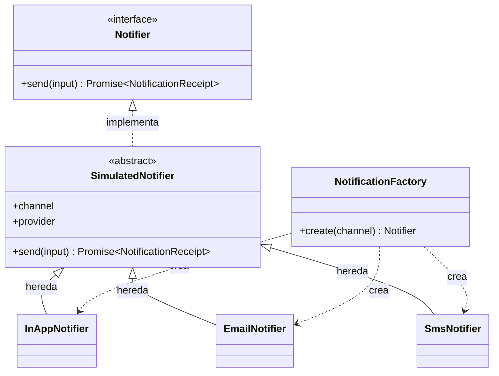
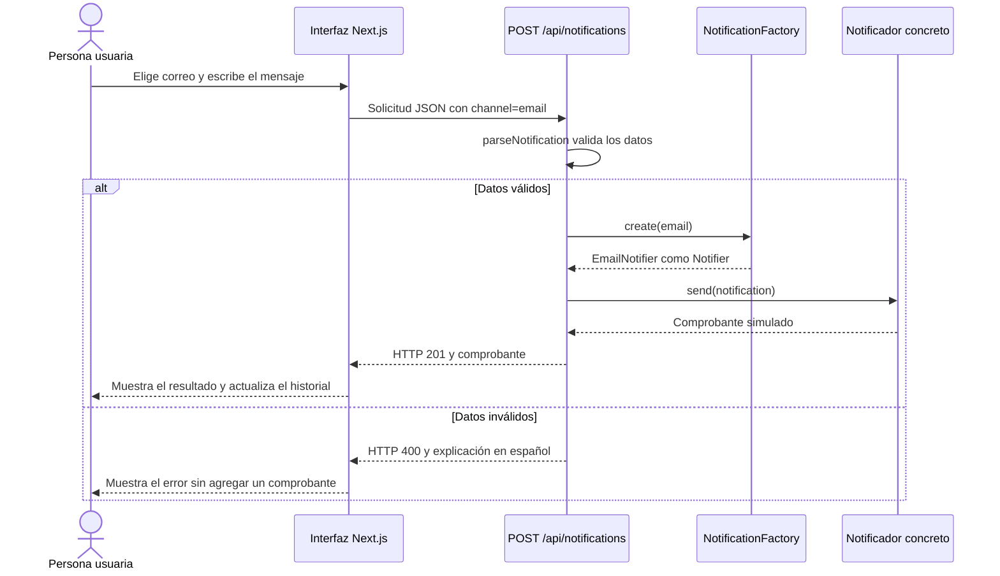
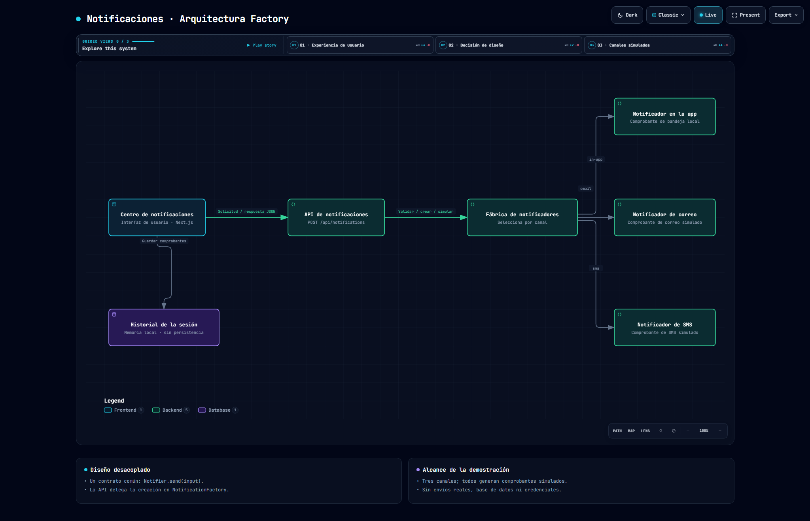

# Centro de notificaciones · Aprender Factory con Next.js

Esta demo funcional muestra **cómo separar la creación de objetos de su uso** mediante una **Simple Factory**. La interfaz permite simular notificaciones en la aplicación, por correo y por SMS. Todos los canales generan comprobantes: **no se envían mensajes reales**.

**Ruta de aprendizaje:** ejecutar la demo → entender el problema → leer el contrato y los productos → seguir la Factory → recorrer una solicitud → estudiar cómo agregar otro canal.

## 1. Ejecutar y explorar la demo

Requisito: Node.js 20.9 o posterior. El entorno utilizado tiene Node.js 24.19.0, Next.js 16.4.2, React 19.3.1 y TypeScript 5.9.3.

Desde la carpeta del proyecto:

```powershell
npm ci
npm run dev
```

Abra **http://127.0.0.1:3000**, seleccione un canal, escriba el destinatario y pulse **Simular notificación**. Observe la vista previa, el comprobante generado y el historial. Puede filtrar la actividad por canal y marcar las notificaciones de la aplicación como leídas.

### Abrir una notificación

En **Actividad reciente**, pulse **Abrir** junto a cualquier comprobante. La ventana de detalle muestra el título, mensaje completo, canal, destinatario, simulador, fecha e identificador.

- Abrir una notificación **En la app** marca únicamente esa notificación como leída y actualiza el contador.
- Abrir un comprobante de correo o SMS no cambia las notificaciones pendientes de la aplicación ni realiza un nuevo envío.
- Puede activar **Abrir** con el teclado y cerrar mediante **Cerrar**, la tecla **Escape** o un clic en el fondo exterior.
- La ventana utiliza el elemento nativo `<dialog>` y conserva el estilo y las preferencias de movimiento reducido.

La demo conserva los últimos 100 comprobantes en memoria de React. Recargar la página borra el historial. No hay base de datos, almacenamiento persistente, notificaciones del sistema operativo ni envío externo. Use destinatarios ficticios.

### Configuración del entorno: `.env.example` y `.env.local`

**Estado del archivo de ejemplo:** su creación automática quedó bloqueada por la regla de permisos que protege `.env.*`. No se creó `.env.example` ni se intentó escribirlo con otra herramienta. Esta sección conserva la plantilla solicitada y las instrucciones; la demo funciona sin archivos de entorno.

El nombre público ya se puede configurar en [`src/lib/config.ts`](src/lib/config.ts). Esta es la plantilla propuesta para `.env.example`, sin secretos:

```dotenv
# Nombre público que aparece en el título de la página y la vista previa.
# Nunca coloque contraseñas o tokens en variables NEXT_PUBLIC_.
NEXT_PUBLIC_APP_NAME="Centro de notificaciones"
```

| Variable | Obligatoria | Valor predeterminado | Dónde se utiliza |
| --- | --- | --- | --- |
| `NEXT_PUBLIC_APP_NAME` | No | `Centro de notificaciones` | Título del navegador y nombre de la vista previa |

Una vez que pueda crear `.env.example` con la plantilla anterior, copie el ejemplo desde la raíz del proyecto, **sin sobrescribir una configuración existente**:

```powershell
if (Test-Path -LiteralPath .env.local) {
  throw 'Ya existe .env.local. Edite su archivo actual; no lo sobrescriba.'
}
Copy-Item -LiteralPath .env.example -Destination .env.local
npm run dev
```

Edite **su archivo local** para personalizar el nombre; por ejemplo, `NEXT_PUBLIC_APP_NAME="Notificaciones del equipo"`. Sin la variable, o con una cadena vacía, la aplicación utiliza el valor predeterminado. No hacen falta credenciales de correo, SMS ni base de datos: los tres canales siguen siendo simulados.

**Reinicio y compilación:** después de cambiar `.env.local`, reinicie el servidor de desarrollo. Las variables `NEXT_PUBLIC_` son públicas y Next.js las incorpora al código del navegador durante el build; para un build de producción, vuelva a ejecutar `npm run build` y después `npm start`. No coloque secretos en ellas. `.env.local` permanece excluido de Git; la plantilla `.env.example` es la única excepción prevista en `.gitignore`.

**Cambiar el puerto:** `PORT` no se configura dentro de `.env.local`, porque Next.js inicia el servidor antes de cargar esos archivos. Use un argumento de la CLI:

```powershell
npm run dev -- --port 3001
# Para un build ya compilado:
npm start -- --port 3001
```

En ese caso, abra **http://127.0.0.1:3001**. Referencias oficiales: [variables de entorno de Next.js](https://nextjs.org/docs/app/guides/environment-variables) y [CLI de Next.js](https://nextjs.org/docs/app/api-reference/cli/next).

## 2. El problema que resuelve Factory

Los tres canales comparten una operación: enviar una notificación. Sin una fábrica, cada consumidor podría decidir qué clase construir y repetir esa decisión:

```typescript
// Ejemplo del acoplamiento que evitamos; no es el código de la ruta.
if (channel === "email") {
  const notifier = new EmailNotifier();
  await notifier.send(input);
}
// Otros consumidores podrían repetir esta selección para SMS y la aplicación.
```

El problema no es tener un `if` o un `switch`. El problema es **dispersar el conocimiento de construcción** entre la API, otros servicios y futuros consumidores.

En esta implementación, la decisión vive en `NotificationFactory.create(channel)`. Quien usa el notificador solo necesita conocer `Notifier.send(input)`.

> **Distinción importante:** implementé una **Simple Factory**, no el patrón GoF **Factory Method**. La primera centraliza la creación en una función o clase; Factory Method utiliza una jerarquía de creadores con un método de creación redefinido por subclases. Aquí no existe esa jerarquía de creadores.

## 3. Mapa del proyecto y responsabilidades

| Pieza | Archivo real | Responsabilidad |
| --- | --- | --- |
| Interfaz de usuario | [`src/app/page.tsx`](src/app/page.tsx) | Componer, mostrar historial y abrir el detalle con lectura individual |
| Presentación | [`src/app/globals.css`](src/app/globals.css) | Diseño adaptable, jerarquía visual y animaciones de entrada |
| Entrada HTTP | [`src/app/api/notifications/route.ts`](src/app/api/notifications/route.ts) | Leer JSON, validar datos y coordinar la simulación |
| Contrato, productos y fábrica | [`src/lib/notifications.ts`](src/lib/notifications.ts) | Definir `Notifier`, crear productos y generar comprobantes |
| Configuración pública | [`src/lib/config.ts`](src/lib/config.ts) | Resolver el nombre opcional con un valor predeterminado |
| Pruebas del comportamiento | [`tests/notifications.test.ts`](tests/notifications.test.ts) | Verificar Factory, contratos, simulación y errores |
| Comprobación HTTP | [`scripts/smoke.mjs`](scripts/smoke.mjs) | Probar la aplicación compilada desde un servidor local real |
| Comprobación de interfaz | [`scripts/browser-smoke.mjs`](scripts/browser-smoke.mjs) | Abrir notificaciones en Chrome y verificar lectura y cierre |

### Diagrama de clases



Los diagramas Mermaid se visualizan en lectores compatibles, como GitHub. Si su lector solo muestra el código, utilice también el [diagrama HTML de Archify](public/architecture.html), que puede abrir directamente en el navegador.

## 4. Cómo lo implementé, paso a paso

### Paso 1: definir los datos y el contrato común

En `src/lib/notifications.ts` definí los datos que recibe cualquier canal:

```typescript
export type Channel = "in-app" | "email" | "sms";
export type NotificationInput = {
  recipient: string;
  title: string;
  message: string;
};

export interface Notifier {
  send(input: NotificationInput): Promise<NotificationReceipt>;
}
```

`Notifier` es el **producto abstracto**: describe qué puede hacer un notificador, sin exigir que el consumidor sepa cómo fue construido. La promesa permite que un adaptador real pueda realizar operaciones asíncronas en una evolución futura; la demo no realiza esos envíos.

`NotificationReceipt` conserva el mensaje normalizado y agrega `id`, `channel`, `provider`, `createdAt` y `status: "simulated"`. El estado usa una clave técnica estable, aunque la interfaz muestra **Simulada**.

### Paso 2: compartir únicamente la simulación común

La clase abstracta `SimulatedNotifier` implementa `send()`. Construye un comprobante con `randomUUID()` y una fecha ISO; no llama a servicios externos.

```typescript
abstract class SimulatedNotifier implements Notifier {
  abstract readonly channel: Channel;
  abstract readonly provider: string;

  async send(input: NotificationInput): Promise<NotificationReceipt> {
    return {
      ...input,
      id: randomUUID(),
      channel: this.channel,
      provider: this.provider,
      status: "simulated",
      createdAt: new Date().toISOString(),
    };
  }
}
```

Esta clase evita repetir el mismo algoritmo simulado tres veces. **No es la Factory**: comparte comportamiento del producto, no decide qué producto crear. La herencia aquí es una elección de la demo, no un requisito de toda Factory.

### Paso 3: crear los productos concretos

Cada canal es una clase distinta que establece su identidad. Por ejemplo:

```typescript
export class EmailNotifier extends SimulatedNotifier {
  readonly channel = "email";
  readonly provider = "Simulador de correo";
}
```

`InAppNotifier` y `SmsNotifier` siguen la misma estructura. Los tres **heredan** `send()`; no tienen tres algoritmos de entrega real ocultos. Lo que varía en esta demo es el canal y la etiqueta del simulador.

### Paso 4: centralizar la construcción en la Factory

Esta es la implementación de la fábrica:

```typescript
export class NotificationFactory {
  static create(channel: Channel): Notifier {
    switch (channel) {
      case "in-app": return new InAppNotifier();
      case "email": return new EmailNotifier();
      case "sms": return new SmsNotifier();
      default: throw new Error("Canal no admitido.");
    }
  }
}
```

La entrada determina la clase concreta; la salida se declara como `Notifier`. Así, la ruta puede usar `send()` sin importar directamente `EmailNotifier`, `SmsNotifier` o `InAppNotifier`.

La rama `default` también importa: TypeScript no protege por sí solo los datos recibidos por HTTP. Primero se valida la solicitud en tiempo de ejecución; además, la fábrica rechaza entradas desconocidas en lugar de elegir silenciosamente un canal.

### Paso 5: consumir la abstracción desde la API

Después de leer el JSON y ejecutar `parseNotification(body)`, la ruta utiliza este fragmento:

```typescript
const { channel, ...notification } = input;
const notifier = NotificationFactory.create(channel);
return Response.json(await notifier.send(notification), { status: 201 });
```

La ruta coordina; la Factory construye; el producto simula. **Cada pieza tiene una responsabilidad concreta.**

### Paso 6: mostrar el resultado sin simular persistencia

`src/app/page.tsx` envía la solicitud con `fetch("/api/notifications", ...)`. Si recibe HTTP 201, incorpora el comprobante al estado de React. El historial no es una base de datos y no se comparte con otras pestañas o usuarios. El diagrama identifica explícitamente esa memoria como no persistente.

La apertura de una notificación también pertenece a esta capa de presentación: `openNotification(receipt)` selecciona el comprobante, marca solo ese identificador como leído cuando su canal es `in-app` y presenta el detalle con `showModal()`. No vuelve a llamar a la Factory ni a la API. La Factory construye notificadores; no administra ventanas ni el estado visual de lectura.

## 5. Recorrido completo de una solicitud



Ejemplo ejecutable desde PowerShell, con la aplicación iniciada:

```powershell
$body = @{
  channel = 'email'
  recipient = 'demo@example.com'
  title = 'Bienvenido al equipo'
  message = 'Esta notificación es una simulación.'
} | ConvertTo-Json

Invoke-RestMethod -Uri http://127.0.0.1:3000/api/notifications `
  -Method Post -ContentType 'application/json; charset=utf-8' `
  -Body ([System.Text.Encoding]::UTF8.GetBytes($body))
```

| Resultado | Respuesta |
| --- | --- |
| Datos válidos | HTTP 201, UUID, fecha, canal, simulador y `status: "simulated"` |
| JSON inválido | HTTP 400 y mensaje en español |
| Canal o campos inválidos | HTTP 400 y explicación del dato que debe corregirse |
| Fallo inesperado al simular | HTTP 500 y mensaje genérico sin detalles internos |

Los canales técnicos siguen siendo `in-app`, `email` y `sms`. El título permite de 1 a 100 caracteres; el mensaje, de 1 a 1000; el destinatario, de 1 a 254, después de quitar espacios exteriores. El correo necesita una dirección válida; SMS usa un número internacional como `+59170000000`; la aplicación usa un identificador no vacío.

## 6. Arquitectura ejecutiva animada con Archify

Abra **[public/architecture.html](public/architecture.html)** directamente, o visite **http://127.0.0.1:3000/architecture.html** con la demo en ejecución. La fuente editable está en **[docs/architecture.json](docs/architecture.json)**.



La imagen es una captura del HTML verificado; la animación y los capítulos guiados están disponibles al abrir el diagrama interactivo, no dentro de esta imagen estática.

El diagrama ofrece tres capítulos para presentar el proyecto:

1. **Experiencia de usuario:** interfaz, API e historial de la sesión.
2. **Decisión de diseño:** validación y creación centralizada mediante Factory.
3. **Canales simulados:** tres productos detrás del mismo contrato.

Se configuró `meta.animation: "trace"`: el visor permite activar **Live** para recorrer visualmente las relaciones y volver a **Still** para detener el movimiento. La animación es finita y controlada por quien presenta; no representa tiempos reales, colas ni métricas de rendimiento. Los capítulos se seleccionan desde el visor y la presentación se inicia con sus controles; no hay reproducción invasiva automática. Se respetan las preferencias de movimiento reducido.

La composición utiliza el perfil de calidad **showcase**, mantiene el estilo clásico de Archify y ofrece temas claro/oscuro y exportación desde el visor. Los textos propios del proyecto están en español. **Limitación de la versión instalada:** los controles fijos y el atributo de idioma del visor solo admiten inglés o chino; se conservó el visor oficial sin modificarlo ni inventar `locale: "es"`. La aplicación Next.js sí declara `lang="es"`.

Archify ya estaba instalado; no se añadió como dependencia de la aplicación ni se actualizó globalmente. El resultado de las verificaciones y las huellas de los archivos se registran en [`docs/verificacion-arquitectura.md`](docs/verificacion-arquitectura.md). Las pruebas deterministas, la evidencia de navegador y la revisión visual son comprobaciones diferentes.

## 7. Cómo agregar otro canal sin mezclar responsabilidades

Como ejercicio futuro, imagine un canal adicional. **No está implementado en esta demo.** El recorrido sería:

1. Agregar su identificador al tipo `Channel` y a la validación de `parseNotification`.
2. Crear un producto que implemente `Notifier`; si también es una simulación, puede extender `SimulatedNotifier`.
3. Agregar su construcción a `NotificationFactory.create()`.
4. Incorporar la opción y la etiqueta en `channels` dentro de la interfaz.
5. Añadir pruebas del canal y actualizar el diagrama y esta documentación.

La coordinación de la ruta no necesita nuevos `if` por canal. Sin embargo, **la fábrica con `switch` sí debe modificarse**. Esta solución no cumple una extensibilidad absoluta sin cambios y no conviene presentarla como tal. Un registro de constructores podría ser una evolución si existiera una necesidad real de extensiones; no hace falta introducirlo para tres simuladores.

Tampoco conviene heredar un algoritmo simulado para un proveedor real y asumir que ya entrega mensajes: una integración real necesitaría su propia implementación de `send()`, manejo de fallos y un contrato de estados adecuado.

## 8. Pruebas y verificación

```powershell
npm test
npm run typecheck
npm run build
npm run test:smoke
# Opcional: Node.js 22 o posterior y Chrome/Chromium instalado.
npm run test:browser
```

`test:smoke` necesita el build. Inicia un servidor de producción temporal en la interfaz local, comprueba la página en español, el diagrama, los tres canales y el rechazo de datos inválidos; luego detiene ese servidor. Para iniciar el build de forma permanente, ejecute `npm start`.

`test:browser` incluye esas comprobaciones HTTP y utiliza una instancia aislada de Chrome/Chromium, sin acceder a su perfil personal. Simula dos notificaciones, abre sus detalles, verifica la lectura individual, prueba activación por teclado y cierre por Escape, botón y fondo exterior. También comprueba que abrir un correo no reduzca el contador de notificaciones de la aplicación. La prueba crea un perfil temporal fuera del proyecto y lo elimina al terminar. Si falta el navegador, informa el fallo sin presentar una aprobación ficticia.

Las pruebas de configuración verifican el nombre predeterminado y un nombre personalizado, sin leer archivos privados ni modificar sus variables de entorno. No se creó `.env.local` durante el desarrollo.

Las pruebas verifican la selección de productos, la forma del comprobante, las etiquetas de los simuladores, los mensajes de error en español y los códigos HTTP. La traducción se probó primero con expectativas que fallaron frente a los textos ingleses y luego se implementó hasta recuperar las pruebas satisfactorias.

**Particularidad del entorno Windows:** los comandos de desarrollo y build usan Webpack explícitamente. El binario nativo SWC no cargó en este entorno y Turbopack no pudo ejecutarse; Webpack permitió utilizar la alternativa WASM. La advertencia nativa puede seguir apareciendo. No se alteraron aprobaciones globales de scripts npm.

## 9. Lo que esta demo enseña y lo que no promete

- **Enseña:** un contrato de producto, productos concretos, construcción centralizada, validación en el límite HTTP y uso polimórfico desde la ruta.
- **No promete:** envíos reales, autenticación, entrega garantizada, reintentos, colas, persistencia, métricas productivas ni preparación para despliegue.
- **Movimiento accesible:** la interfaz utiliza entradas y transiciones breves; `prefers-reduced-motion` las desactiva. El diagrama conserva significado completo sin animación.
- **Identificadores estables:** los nombres de clases, propiedades JSON, rutas y comandos se conservan porque son contratos técnicos, no textos de presentación.

**Para comprobar que comprendió el patrón:** localice quién crea el objeto, quién lo utiliza y por qué la ruta puede invocar `send()` sin conocer la clase concreta. Esa separación es el objetivo de esta implementación.
